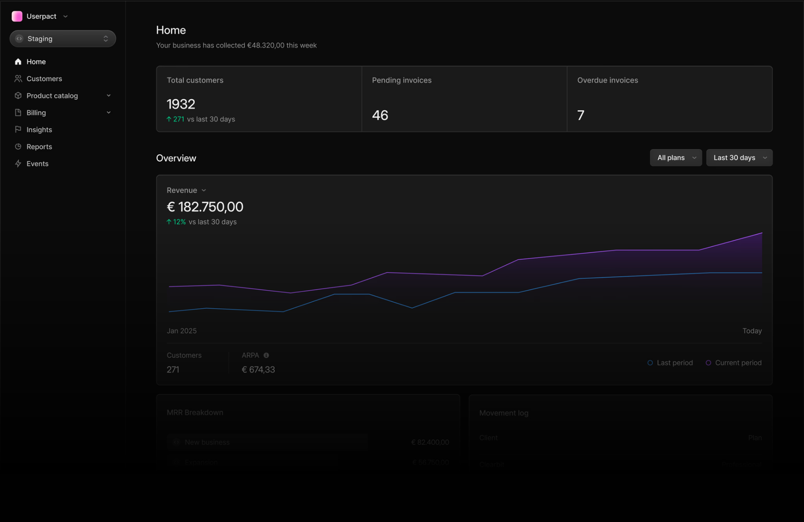
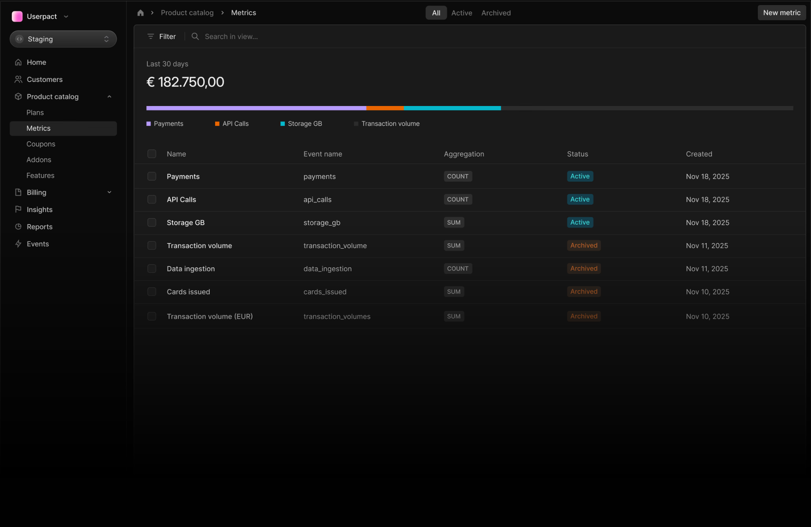
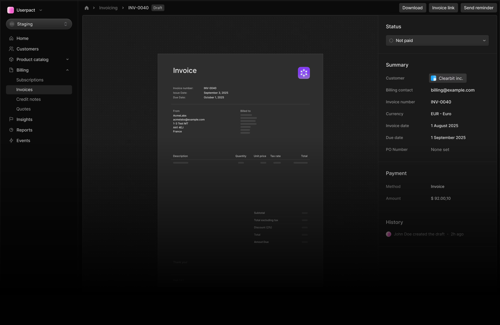

<div align="center">


  <a href="https://www.meteroid.com?utm_source=github" target="_blank">
  <picture>
    <source media="(prefers-color-scheme: dark)" srcset="assets/meteroid-logo-wordmark--dark.svg">
    
  </picture>
  </a>
</div>

<h3 align="center">
  Cloud-native pricing and billing platform for SaaS, Infrastructure, and AI companies 🔥.
</h3>

<br/>

<p align="center">
  <a href="CODE_OF_CONDUCT.md">
    
  </a>
  <a href="LICENSE">
    
  </a>
  <a href="https://go.meteroid.com/discord?utm_source=github">
    
  </a>
   
    <a href="https://twitter.com/meteroidhq">
    
  </a>
</p>

<div align="center">

🚀 **Meteroid 2.0 is out:** credits and wallets, e-invoicing, native webhooks, and a new open-source baseline.
[Announcement](https://github.com/meteroid-oss/meteroid/discussions/1270) ·
[Release notes](https://github.com/meteroid-oss/meteroid/releases/tag/v2.0.0) ·
[Upgrade guide](https://docs.meteroid.com/self-hosting/upgrading-to-2-0)

</div>

<br/>

Meteroid is an open-source billing platform for usage-based, subscription and hybrid pricing. It meters
your product's usage, prices it with your plans, and runs the whole cycle from quote to invoice and
payment, so your engineers stop maintaining a homegrown billing system and your finance team stops
reconciling spreadsheets.

<div align="center">

💡 **Just want to try it?** Spin up a free workspace on
[Meteroid Cloud](https://app.meteroid.com/registration?source=github-readme-hero), ready in seconds, no credit card, hosted in the EU.


<table>
  <tr>
    <td></td>
    <td></td>
    <td></td>
  </tr>
</table>


**We'd love your support or contribution! Leave a star ⭐ and join our [Discord](https://go.meteroid.com/discord?utm_source=github)!**

</div>
 

## Features

- [**Usage metering:**](https://docs.meteroid.com/metering/billable-metrics) send raw events (API calls,
  tokens, transactions, storage) and turn them into billable metrics in real time, with filters on event
  properties and a live preview while you author them. Events are deduplicated at ingestion.
- [**Plans and pricing:**](https://docs.meteroid.com/billing/managing-plans) flat, per-unit, tiered,
  volume, package, matrix and capacity pricing, or any mix of them. Plans are versioned, so a price change
  never touches existing customers unless you want it to.
- **Credits and wallets:** prepaid and promotional credit per currency, with grants, priorities, expiry
  and a full ledger, applied at invoicing, and top-ups customers buy from the portal. With the Enterprise
  images: your own credit units, credit packs in plans, scoped credit, and usage beyond the balance billed
  as overage.
- [**Subscriptions:**](https://docs.meteroid.com/subscriptions/what-is-a-subscription) trials, coupons,
  add-ons, upgrades and downgrades mid-cycle with proration, and cancellations that credit what was paid in
  advance.
- [**Quotes:**](https://docs.meteroid.com/quotes/introduction) send a quote, get it signed, and the
  subscription starts and bills on its own. Several signers and purchase orders come with the
  Enterprise images.
- [**Invoicing:**](https://docs.meteroid.com/invoices/managing-invoices) invoices and credit notes in eight
  languages, tax-inclusive or exclusive prices, e-invoicing as Factur-X or XRechnung, and payment
  reminders before and after the due date. Reminder sequences per customer group come with the
  Enterprise images.
- [**Payments:**](https://docs.meteroid.com/integrations/general-information) Stripe, GoCardless, Mollie and Stancer, with automatic retries, refunds, and a customer
  portal and hosted checkout. Customers change their own plan, add-ons and seats from the portal
  with the Enterprise images.
- [**Entitlements:**](https://docs.meteroid.com/entitlements/create-and-manage-entitlements) control what
  each customer can access or consume, from feature flags to metered limits.
- **API, webhooks and integrations:** a REST API with SDKs, signed webhooks with retries and a delivery
  log, and a growing list of connectors.

Meteroid Enterprise adds many features such as [revenue reports and analytics](https://docs.meteroid.com/analytics/overview), live balances, limits, budgets, tax reports, SSO, audit log and more: see [Editions and images](#editions-and-images).

## Quick start

Run Meteroid on your machine with Docker Compose:

The default images are Meteroid Enterprise (free under 50 employees and €2M in annual revenue). For the AGPL images built from this repository, add [`-f docker-compose.oss.yml`](docker/deploy/docker-compose.oss.yml): `docker compose -f docker-compose.yml -f docker-compose.oss.yml up -d`.

```bash
git clone https://github.com/meteroid-oss/meteroid.git
cd meteroid/docker/deploy
cp .env.example .env   # set the secrets it lists
docker compose up -d
```

Then open [http://localhost:3000](http://localhost:3000) and create your account. For a server, follow
[Deploy with Docker Compose](https://docs.meteroid.com/self-hosting/docker-compose). For production, use the
[Helm chart](https://docs.meteroid.com/self-hosting/kubernetes) in [`k8s/meteroid`](k8s/meteroid).

Upgrading from 0.19 or a 1.0.0 release candidate? Follow
[Upgrading to 2.0](https://docs.meteroid.com/self-hosting/upgrading-to-2-0).

## Editions and images

This repository is the open-source edition, under the AGPL V3. Its images are published on each release as
`ghcr.io/meteroid-oss/meteroid-oss-api`, `meteroid-oss-worker`, `meteroid-oss-metering` and `meteroid-oss-web`:
use them with the Compose override [`docker-compose.oss.yml`](docker/deploy/docker-compose.oss.yml) or the Helm
chart's `edition: oss`. You can also build them from this repository. Both editions share the same database, so you
can switch by changing the images.

The default images (`ghcr.io/meteroid-oss/meteroid-api`, `meteroid-worker`, `metering-api` and
`meteroid-web`) are Meteroid Enterprise: the code of this repository plus the Enterprise modules. They are
free for companies under 50 employees and €2M in annual revenue under the
[Enterprise license](editions/enterprise/LICENSE), and some Enterprise features come free with
them: tax reports, MRR and revenue reports, live balances and usage limits, credit units and packs,
portal self-service and customer email customization. Larger companies need a
commercial license, and a license unlocks the rest. See
[Editions](https://docs.meteroid.com/self-hosting/editions).

[Meteroid Cloud](https://app.meteroid.com/registration?source=github-readme-hero) is the managed service, run by the Meteroid team and hosted in Europe.

## Services

- **API** (Rust): the gRPC API used by the web app and the public REST API.
- **Worker(s)** (Rust): invoicing, payments, emails, webhooks and every scheduled job.
- **Metering API** (Rust): event ingestion at scale through Kafka into ClickHouse, deduplication and usage queries.
- **Web app** (React and TypeScript).
- **Storage:** PostgreSQL 18 with `pgmq`, ClickHouse, Kafka, Redis (optional) and S3-compatible object storage.

## Contributing

This repository receives the code from the repository Meteroid is developed in, one commit per change with
its original author. Pull requests are welcome here: once a maintainer approves one, it is replayed upstream
and comes back with the next export, under your name. See the [contributing guide](CONTRIBUTING.md) to
build Meteroid from source.

## License

Copyright 2026 Meteroid

The code of this repository, and the `meteroid-oss-*` images built from it, are licensed under the AGPL V3
License: see [LICENSE](LICENSE). The default images, Meteroid Enterprise, are licensed under the Meteroid
Enterprise License: see [editions/enterprise/LICENSE](editions/enterprise/LICENSE).

For enterprise support, licenses or custom licensing options, contact us at
[hey@meteroid.com](mailto:hey@meteroid.com).

## Contributors ✨

<a href="https://github.com/meteroid-oss/meteroid/graphs/contributors">
  <p align="left">
    
  </p>
</a>

Join us on <a href="https://go.meteroid.com/discord?utm_source=github">Discord</a> !

Thanks for the support 💖
